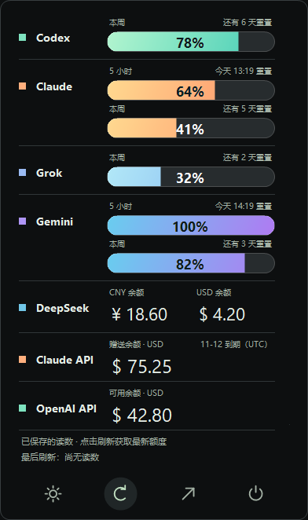

# AI head-up dispaly · AI 余量

把 AI 订阅额度和 API 余额放进一个 Windows 托盘面板。点击更新，后台并行读取；每家完成后立即显示。



*预览使用虚构演示数据，不包含真实账户或余额。*

## 功能

- **统一查看**：Codex、Claude、Grok、Gemini、DeepSeek API、Claude API。
- **共享额度去重**：Claude 网页版与 Claude Code 共享订阅池；短周期与周额度分别显示，不相加。
- **直观看剩余量**：渐变胶囊按剩余百分比填充，旁边显示重置倒计时或时间。
- **按需后台刷新**：不定时采集、不在浏览器启动时采集；各平台并行更新，失败保留旧值。
- **隐藏网页采集**：点击刷新时使用独立采集窗口，先以最小化且不聚焦的方式创建，再由桌面程序隐藏；确认隐藏后才打开各家用量页，结束后关闭。不会在日常浏览窗口添加标签页。创建瞬间任务栏可能短暂出现图标。Edge 可在后台运行；未登录或扩展未连接时会保留旧数据并提示。
- **系统托盘**：关闭工具栏后继续驻留；右键查看额度，底部直接切换亮暗、刷新、打开工具栏或退出。
- **本地保存**：无云同步、遥测或远程数据库。DeepSeek 密钥使用当前 Windows 用户的 DPAPI 加密。

## 数据来源

| 来源 | 读取方式 | 显示内容 |
| --- | --- | --- |
| Codex | 本机 Tokscale `usage --json` | 官方返回的订阅额度周期 |
| Claude | Edge 扩展读取官方用量页 | 五小时、周额度；不重复计入 Claude Code |
| Grok | Edge 扩展读取官方账户及用量页 | 周额度总读数 |
| Gemini | Edge 扩展读取官方用量组件 | 当前周期和周额度 |
| DeepSeek API | 官方只读余额接口 | CNY / USD 独立余额 |
| Claude API | Edge 扩展读取账单页文字 | 赠送余额、原始额度、适用范围和 UTC 到期日 |

Claude API 显示当前登录 Console 账单页的快照，不依赖账户菜单或组织 ID，不宣称验证了组织身份。充值金额按界面设计隐藏；API 金额不转换为订阅百分比。

Codex 的读数不代表 ChatGPT 所有网页功能的总额度。套餐名称、可用窗口及重置规则以提供方实际页面为准。

## 快速开始

### 环境

- Windows 10 / 11。
- Node.js 22 或更新版本、npm。
- Microsoft Edge，用于复用已有的网站登录和加载本地扩展。
- Windows .NET Framework C# 编译器；构建脚本会检测系统的 Framework64 / Framework 目录。
- 如需自动读取 Codex：安装并登录 [Tokscale](https://github.com/junhoyeo/tokscale)，使其可执行文件可被找到。

### 安装并启动

下载或克隆仓库，在项目目录打开 PowerShell：

```powershell
npm.cmd ci
npm.cmd run build:desktop
.\AI-head-up-dispaly.exe
```

仓库包含源码，不包含本机构建的 EXE。构建命令会生成 `AI-head-up-dispaly.exe` 和 `desktop/CredentialVault.exe`。

升级时会保留兼容的 `Headroom.exe` 入口，已有快捷方式、启动项和配对数据可继续使用。

启动后可从右下角系统托盘找到 AI head-up dispaly。左键打开独立工具栏，右键直接查看额度；图标可能收在 Windows 的「˄」里。关闭工具栏不会退出托盘。

完整面板位于 [http://127.0.0.1:4317](http://127.0.0.1:4317)，工具栏位于 [http://127.0.0.1:4317/toolbar](http://127.0.0.1:4317/toolbar)。只运行网页服务可使用 `npm.cmd start`。

### 配对浏览器扩展

1. 在 Edge 打开 `edge://extensions`，开启「开发人员模式」。
2. 点击「加载解压缩的扩展」，选择项目的 `extension` 文件夹。
3. 打开 AI head-up dispaly 完整面板，在「接入与数据」中获取配对码。
4. 点击 Edge 工具栏里的 AI head-up dispaly 扩展，粘贴配对码并开启。
5. 确保需要采集的网站已经登录，再点击 AI head-up dispaly 的刷新按钮。

扩展使用已有登录，创建自己的后台临时设置页，读取完成后关闭。临时页丢失时会新建一次重试，不重载或关闭用户自己的页面。更新扩展源码后，需要在 Edge 扩展管理页点击一次「重新加载」，已有配对保留。

扩展权限限于 `claude.ai`、`platform.claude.com`、`grok.com`、`gemini.google.com` 和本机 `127.0.0.1:4317`。没有 cookies、history、debugger 权限；只在明确收到采集指令且进入匹配的设置或用量路径后读取相关 DOM。

### 连接 DeepSeek

在工具栏点击 DeepSeek 名称，或在完整面板点击「连接 API」，填写已有 API Key。密钥只应输入本机表单。

连接时调用官方 `GET https://api.deepseek.com/user/balance`，验证成功后以 Windows DPAPI 加密保存；不会调用模型。也支持 `DEEPSEEK_API_KEY` 环境变量，设置后需重启服务。

### 配置 Tokscale 路径

默认尝试已存在的 Windows Bun 4.20.1 缓存，再尝试 PATH 中的 `tokscale.exe` / `tokscale`。AI head-up dispaly 不会自行运行 `bunx` 下载程序。

找不到时，在项目根目录创建未纳入 Git 的 `local-config.json`：

```json
{
  "tokscalePath": "C:\\Tools\\tokscale.exe"
}
```

也可以在完整面板导入 `usage --json` 输出，或手动记录作为备用。

## 托盘操作

| 图标 | 操作 |
| --- | --- |
| ☀ / ☾ | 切换亮色和暗色 |
| ↻ | 后台刷新全部来源 |
| ↗ | 打开工具栏 |
| ⏻ | 退出 AI head-up dispaly |

托盘与工具栏底部显示「最后刷新」时间（马德里时间，精确到秒），取最近一次成功读入的数据时间；不代表所有平台都已同时更新。读取失败会保留各平台原有读数，重新启动后仍能显示保存的时间。

打开工具栏右上角的设置，可管理「登录 Windows 时启动」。开启后会在当前用户的 Windows「启动」文件夹创建快捷方式，并移除本安装目录的旧版注册表启动项，避免重复启动。启动后只驻留托盘，不自动采集。移动项目位置后，需要重新设置启动项。

退出会关闭托盘及工具栏，并停止由该托盘启动的服务；原本由命令行等其他入口启动的独立服务会保留。构建新版 EXE 前请先退出托盘程序。

## 额度与隐私规则

- 同一平台、同一账户、同一功能范围和同一周期只保留一个当前读数，不累加百分比。
- 短周期、周额度、不同币种和 API 金额分别显示。
- 未知不等于零；超过 15 分钟、采集失败或已到重置时间会标记旧值，不自行补成 100%。
- Claude API 只展示一份当前账单页快照，不与历史账户快照相加。
- 重置时钟当前使用 `Europe/Madrid`；赠送额度到期日期保留官方 UTC 日期。
- 服务只监听 `127.0.0.1`，校验 Host、Origin、客户端请求头及扩展配对密钥。
- 本应用不读取密码、Cookie 或对话。Tokscale 的认证和采集行为由其自身实现。

本机数据保存在 `data/`。其中包含配对密钥、加密 API Key、额度历史和偏好，应留在自己的电脑上。`data/`、日志、个人配置、内部验证记录和构建产物均已加入 `.gitignore`。

## 当前限制与排查

- 网页读取依赖提供方页面结构和语言；已适配的主要页面为 Claude 英文、Grok 西班牙文及 Gemini 中文。页面改版后可能需要更新解析器。
- **Grok 的账户身份读取目前仍可能失败**，届时保留旧值并显示读取失败。
- 浏览器、扩展和本机服务都需要运行。出现未连接提示时，先确认 Edge 已打开、扩展已配对。
- 网站登录失效时，在原网站重新登录；不要向聊天、Issue 或仓库提交凭据。
- 没有跨平台「总剩余百分比」、额度通知、云同步或自动定时采集。
- 浏览器相关 API 的可用性可能因套餐、地区和账号而不同；没有对应官方页面时显示未知。

## 开发与检查

```powershell
npm.cmd test
npm.cmd run test:desktop
```

`test:desktop` 在 Windows 上编译并运行原生额度、重置时间和进度胶囊像素检查。GitHub Actions 会从源码构建并运行这两组检查。

```text
desktop/     Windows 托盘、启动器、DPAPI 组件
extension/   Edge DOM 采集与本机桥接
lib/         额度去重、来源适配与余额校验
public/      完整面板和紧凑工具栏
scripts/     Windows 构建与原生测试入口
test/        Node.js 回归测试
server.mjs   本机 HTTP / WebSocket 服务
```
